# Segundo Parcial · Seguridad de Redes (DHCP, OSPF cifrado, CIS, AAA/RADIUS, SSH y Zabbix)

> ▶️ **Video de la demostración:** [https://youtu.be/F_GN2BGLCpo](https://youtu.be/F_GN2BGLCpo)

**Estudiante:** Gregorys Morel Duluc · **Matrícula:** 2025-0035 · **Materia:** Seguridad de Redes · **ITLA**

---

## 1. Propósito

Implementar y demostrar una infraestructura de red segura con equipos Cisco, un servidor Windows (Active Directory + NPS) y un servidor Zabbix, cubriendo: asignación dinámica de direcciones (DHCP), enrutamiento OSPF con autenticación cifrada, análisis del router contra el CIS Benchmark, registro (logs) de AAA y RADIUS, acceso administrativo solo por SSH y monitoreo SNMP con Zabbix.

## 2. Topología y direccionamiento (basado en la matrícula 2025-0035)

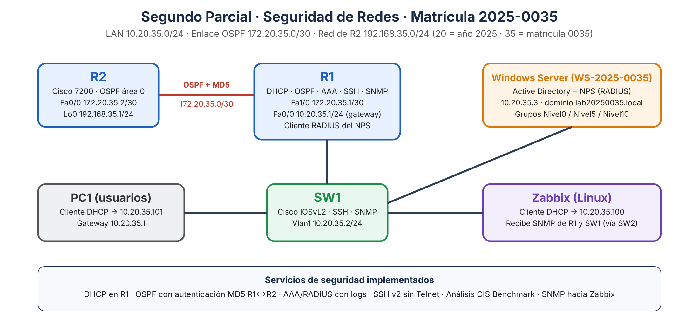

Topología en GNS3 (el Windows Server es una VM de VirtualBox conectada por el nodo *Cloud1*):

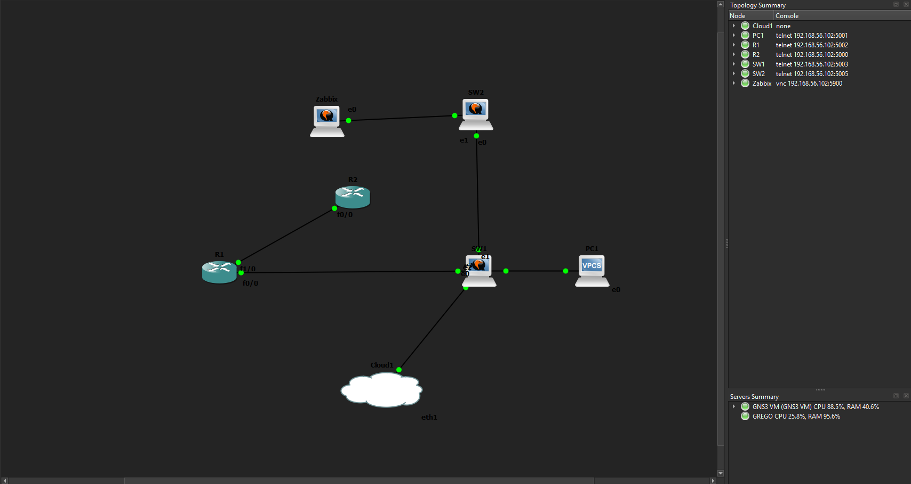

El direccionamiento sale de la matrícula **2025-0035**: `20` = año 2025 y `35` = número 0035.

| Equipo | Rol | Interfaz | Dirección |
|---|---|---|---|
| R1 | Router Cisco 7200: DHCP, OSPF, AAA, SSH, SNMP | Fa0/0 | 10.20.35.1/24 |
| R1 | | Fa1/0 | 172.20.35.1/30 |
| R2 | Router Cisco 7200: OSPF | Fa0/0 | 172.20.35.2/30 |
| R2 | | Loopback0 | 192.168.35.1/24 |
| SW1 | Switch Cisco IOSvL2: SSH, SNMP | Vlan1 | 10.20.35.2/24 |
| SW2 | Switch Cisco IOSvL2 (acceso de Zabbix) | Vlan1 | 10.20.35.5/24 |
| WS-2025-0035 | Windows Server: Active Directory + NPS | NIC | 10.20.35.3 |
| Zabbix | Servidor Zabbix (Linux), **cliente DHCP** | eth0 | 10.20.35.x (DHCP de R1) |
| PC1 | PC de usuarios, **cliente DHCP** | e0 | 10.20.35.x (DHCP de R1) |

## 3. Requisitos y evidencias

### 3.1 DHCP en el router (requisito 1)

R1 es el servidor DHCP de la LAN (`ip dhcp pool LAN-2025-0035`, red 10.20.35.0/24, gateway 10.20.35.1). PC1 recibe su dirección por DHCP:

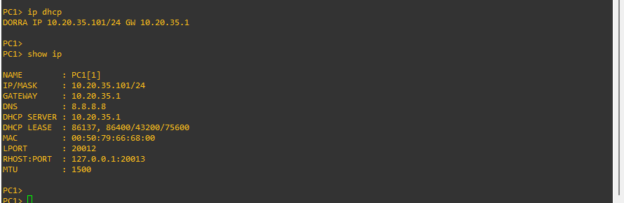

En R1, `show ip dhcp binding` muestra las direcciones entregadas a los clientes de la LAN (Zabbix y PC1) (parte inferior de la imagen):

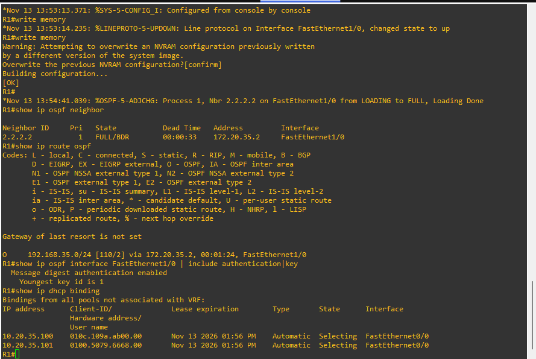

### 3.2 OSPF con autenticación cifrada (requisito 2)

OSPF área 0 entre R1 y R2 con autenticación **MD5** (`ip ospf authentication message-digest` + `ip ospf message-digest-key 1 md5 ...`).

En R1: vecino 2.2.2.2 en estado **FULL**, ruta aprendida `O 192.168.35.0/24` y *Message digest authentication enabled* (imagen anterior).

En R2: vecino 1.1.1.1 en estado **FULL**, ruta aprendida `O 10.20.35.0/24` y autenticación MD5 activa:

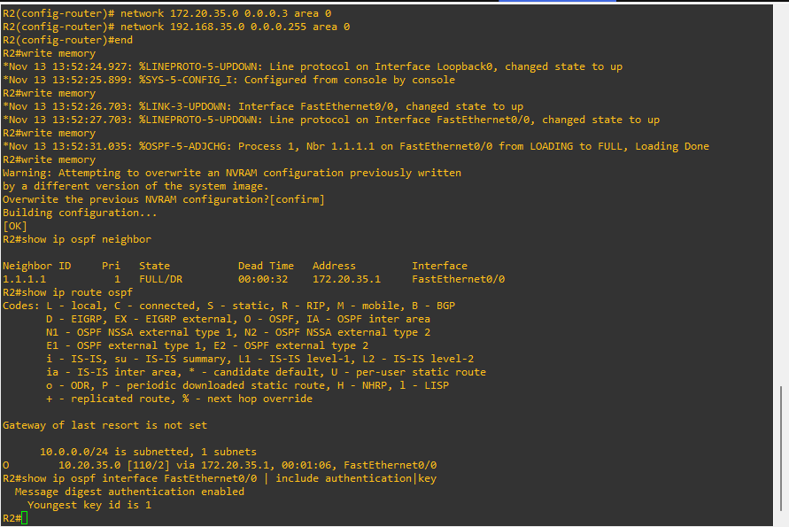

### 3.3 Análisis CIS del router (requisito 3)

Herramienta: script propio [`scripts/cis_hardening.py`](scripts/cis_hardening.py) (Python), que descarga el `running-config` por consola y evalúa 21 recomendaciones del **CIS Cisco IOS Benchmark** en modo solo auditoría (no aplica cambios).

**Informe inicial del router R2 con los hallazgos** (3/20 controles cumplidos, 17 hallazgos):

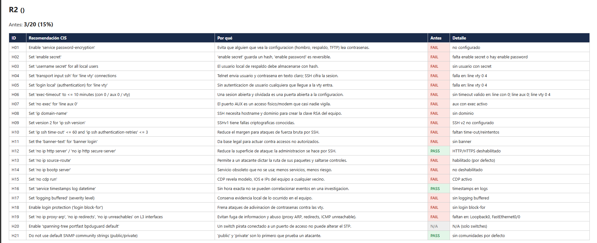

Informe del router R1 (18/20; los 2 hallazgos corresponden a la nueva interfaz hacia R2 y al uso de AAA en las vty):

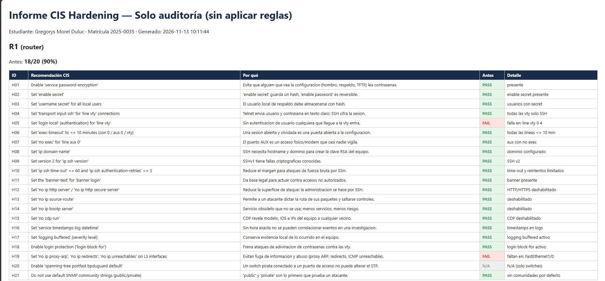

Los informes completos están en [`reports/`](reports/).

### 3.4 Logs de AAA y RADIUS (requisito 4)

R1 autentica contra el NPS (RADIUS, 10.20.35.3) con usuarios de Active Directory. Logs habilitados: `login on-success log`, `login on-failure log`, `logging buffered`, `aaa accounting exec` y depuración de AAA/RADIUS.

Prueba de RADIUS desde R1 (`test aaa`): usuario del dominio autenticado con privilegio 10:

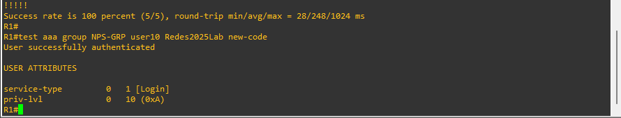

Acceso por SSH con `user10`: primero **exitoso** (clave correcta) y luego **fallido** (clave incorrecta):

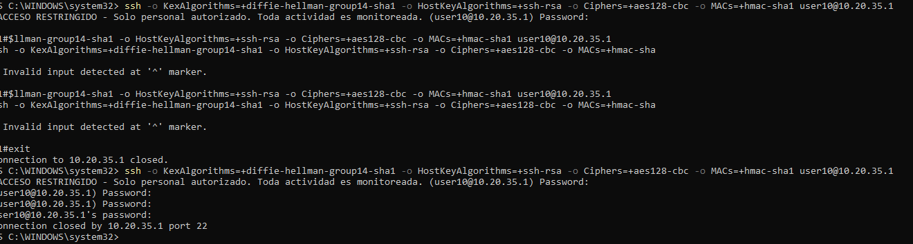

**Log de R1**: `Access-Accept` + `%SEC_LOGIN-5-LOGIN_SUCCESS` (acceso exitoso) y `Access-Reject` + `%SEC_LOGIN-4-LOGIN_FAILED` (acceso fallido):

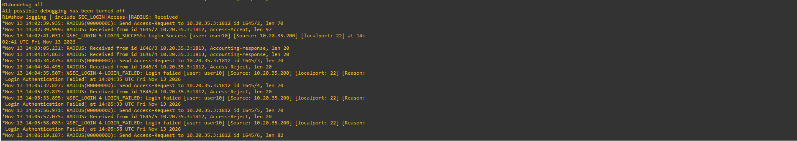

### 3.5 Repositorio (requisito 5)

- `README.md`: esta documentación, con el video al inicio y las evidencias incrustadas.
- [`configs/`](configs/): un archivo de configuración por equipo de red (R1, R2, SW1).
- [`img/`](img/): diagrama y evidencias.
- [`scripts/`](scripts/) y [`reports/`](reports/): herramienta de análisis CIS y sus informes.

### 3.6 Direccionamiento, hostname y conectividad (requisito 6)

Direccionamiento basado en la matrícula (tabla de la sección 2) y hostname en todos los equipos (R1, R2, SW1, SW2). PC1 alcanza su gateway y la red de R2 a través de OSPF:

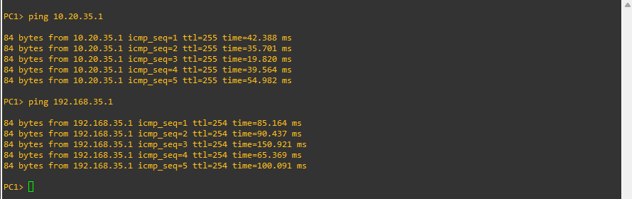

### 3.7 Acceso administrativo por SSH, sin Telnet (requisito 7)

En R1 y SW1: usuario local con contraseña cifrada (`username admin privilege 15 secret ...`), SSH versión 2 y `transport input ssh` en las vty. Telnet (puerto 23) cerrado en R1 y SW1; SSH (puerto 22) abierto:

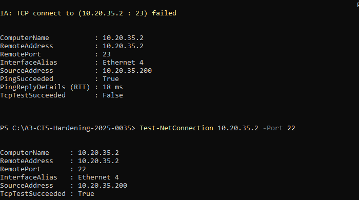

### 3.8 Zabbix como cliente DHCP con datos SNMP (requisito 8)

El servidor Zabbix obtiene su dirección como **cliente DHCP** del router R1 (`DHCPOFFER from 10.20.35.1`, `bound to 10.20.35.100`):

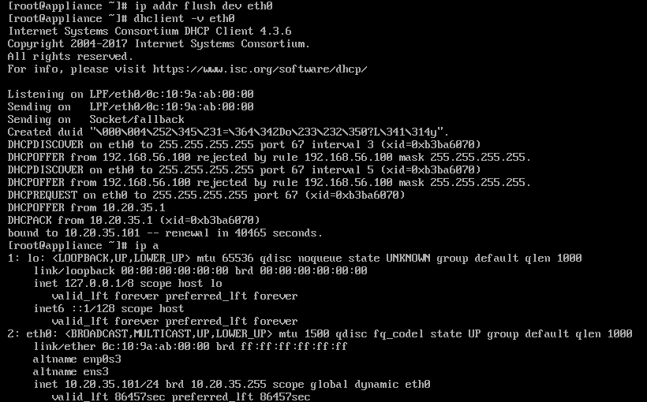

Y recibe los datos SNMP (comunidad de solo lectura) del router y de los switches. Host R1 con disponibilidad **SNMP en verde**:

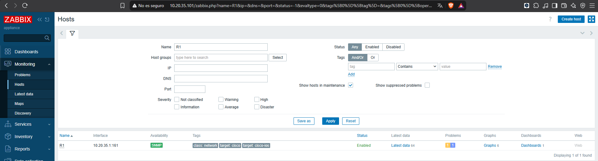

*Latest data* con valores recibidos por SNMP de R1, SW1 y SW2 (R1: 64 ítems, SW1: 104 ítems):

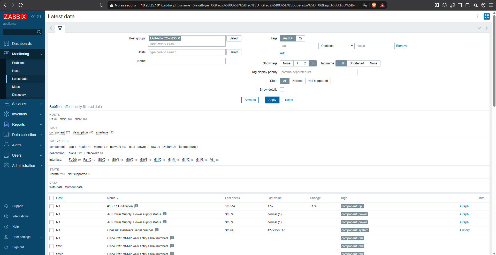

Tras reiniciar el laboratorio, Zabbix volvió a obtener dirección por DHCP del pool de R1 (`10.20.35.100`) y responde al ping desde el equipo de administración:

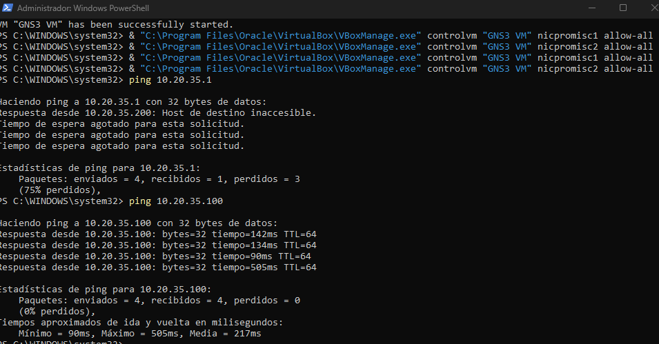

## 4. Archivos de configuración

| Equipo | Archivo |
|---|---|
| R1 | [`configs/R1-running-config.txt`](configs/R1-running-config.txt) |
| R2 | [`configs/R2-running-config.txt`](configs/R2-running-config.txt) |
| SW1 | [`configs/SW1-running-config.txt`](configs/SW1-running-config.txt) |
